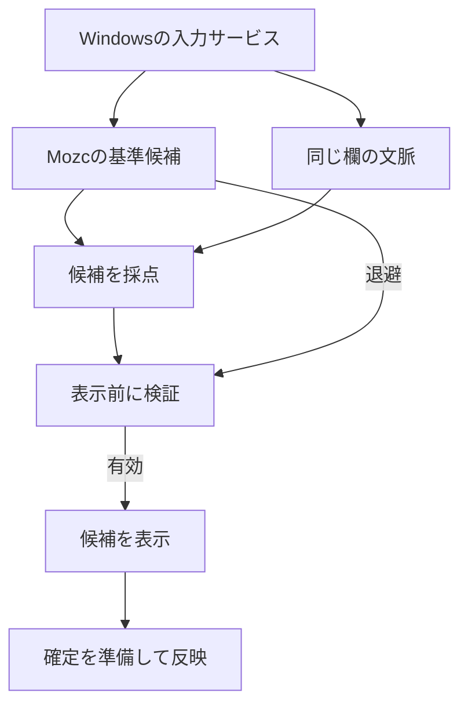

# 軽量ローカルAI日本語入力システム 設計書

改訂版 0.4（2026年11月12日）

端末内のAIで、かな漢字変換の訂正を減らす。現在の読みと、同じ入力欄で保持した数行の文脈を使い、入力途中の予測とスペースキーでの変換を改善する。入力の応答時間、CPU使用量、常駐メモリも測り、日常入力に適した構成を選ぶ。

Windows 11 x64、Mozc、CPUでの推論は初版の試作前提。3行、候補数、容量、処理時間の数値は試作の初期値として扱う。速度と変換精度は実装後に測定する。

0.3版で未確定入力の保持、確定と復旧、予測の再開、評価の手順を具体化した。0.4版では通常編集の成功確認、応答消失からの回復、予測候補と評価の条件を補った。 [0.1版の全88行レビュー](https://chatgpt.com/library?file_id=libfile_81e26344edfc819180610b225ed80d1f&account_id=personal)・[0.2版の全197行レビュー](https://chatgpt.com/library?file_id=libfile_32f2fa3144e48191a208c1ddfe855329&account_id=personal)・[0.3版の全300行レビュー](https://chatgpt.com/library?file_id=libfile_7c124fa36864819192cd92ae255dc8a0&account_id=personal)

## 1. 採用構成

MozcのWindows入力サービス（TSF）、ローマ字・かな入力、辞書、文節操作を再利用する。変換サーバーにC++の小型モデルを組み込み、候補生成後に読みと文脈で採点する。辞書とモデルを同梱し、運用時の変換・予測は端末内で完結させる。

| 構成 | 役割 | 採用判断 |
|---|---|---|
| Mozcの辞書変換・予測 | 入力と候補生成を担う。AIを使えない場合の変換にも使う | 同じ版・辞書・設定を固定し、応答と品質の基準にする |
| Mozc＋文脈による候補の再評価 | 正解が候補にある場合に順位を改善する。予測では読みを確認できた語を追加できる | 初版の試作方式。候補到達率と訂正回数を測って採用を決める |
| 既存のローカルニューラル変換 | zenzを使うMozkeyや、独自に候補を探索するshunti IMEを比較対象にできる | 容量、精度、負荷を同一条件で比べる。配布ファイル容量と実行時メモリはそれぞれ測る |

変換の正解が候補集合にない場合や、文節の切り方が違う場合は、辞書・候補探索の改善が必要になる。上位候補の範囲を決める前に、正解の到達順位と、保護枠や最大1文節の昇格を守った場合の改善の上限を測る。

[Windows版Mozcのビルド手順](https://github.com/google/mozc/blob/a4541df29db443b49f81cf54665873b68fde9efa/docs/build_mozc_in_windows.md)・[Mozkey](https://github.com/koyasi777/mozkey)・[zenzのモデルファイル](https://huggingface.co/Miwa-Keita/zenz-v3.2-xsmall-gguf/tree/main)・[shunti IME](https://github.com/shuntilettuce/Japanese-IME-for-HarmonyOS-next)

TSF側は入力欄・未確定範囲・表示・文書への書き込みを管理する。サーバーのセッション所有スレッドは候補の登録と読みの消費を管理する。採点ワーカーは読み・文脈・候補のコピーを評価し、得点を返す。未確定入力の保持、通常編集と確定の成功確認、操作結果の照会を既存Mozcの改修範囲に含める。

## 2. 最大3行の文脈メモリ

### 範囲と上限

| 項目 | 試作仕様 |
|---|---|
| 読み取りの起点 | 確定済みテキストのカーソル位置。未確定入力中は未確定範囲の先頭、範囲選択中は置換対象の文書上の先頭 |
| 行の数え方 | 最大3論理行。起点より左にある現在行の部分と、その前の最大2行を数える。空行も1行とする。画面上の折り返しは同じ行 |
| 改行 | CRLFは1境界として扱う。LF、CR、U+2028、U+2029も行境界とする。アプリ固有の段落境界は対応を確認できたものを変換する |
| 読み取り上限 | 起点から後方へ最大1,024 UTF-16コード単位。同じ欄の許可範囲で止め、実際に取得できた単位数を使う |
| 保持上限 | 各行の末尾から128 Unicodeコードポイント、合計384まで。元の行位置を保ち、欠落した行を詰めて並べない |
| 取得状態 | 取得済み、確認できた空行、未取得を区別する。読み取り範囲・保持上限のどちらで切れたかも記録する |
| 保持場所 | TSF側のRAMと、採点に必要なサーバー内のコピー。未確定入力の保持とは別に管理する |

現在行に「あ」が1,100個続く場合、後方1,024単位には前の改行が入らない。現在行の末尾は確認できる書記素境界から使い、前2行は未取得とする。前の入力欄の記憶で穴を埋めない。

**文字処理の順序。** 試作はUnicode 17.0.0の書記素規則とutf8proc v2.11.3を固定して使う。取得したUTF-16を検証・デコードし、改行で分け、書記素を壊さず各行の左側を切って128コードポイント以下にする。その後、特徴用のコピーを行ごとにNFCにし、特徴側にも同じ上限を適用する。確定する元の表記と読みの位置は特徴用の文字列とは別に保持する。

左端が読取上限で切れた場合、分断されたサロゲートの断片を除き、行頭・完全な改行の直後・未読部分に依存しないと確認できた書記素境界から分割する。例えば連続する普通の「あ」の間は開始点にできる。先頭のLFだけから、その前が空行だとは判定しない。結合文字列、ZWJ絵文字、地域指示記号の列で確かな開始点が得られない場合や、壊れたUTF-16を含む場合は、該当行を未取得にする。切詰めで文字が残らない非空行も「確認できた空行」とは数えない。学習・評価で同じ手順と版を使う。

[書記素境界：UAX #29の固定版](https://www.unicode.org/reports/tr29/tr29-47.html)・[utf8proc v2.11.3](https://github.com/JuliaStrings/utf8proc/releases/tag/v2.11.3)

### 欄の識別、取得、失効

- **欄の識別。** TSFコンテキストの寿命と、確認できた入力欄の境界を組み合わせて欄IDを付ける。同じ文字列や同じTSFコンテキストだけで欄を同一視しない。フォーカス世代は欄が移るたびに更新し、元の欄に戻ったときにも進める。
- **要求の照合。** クライアントとサーバーの起動識別子、セッション、欄IDとフォーカス世代、文書・読み・機密区分の世代、候補集合、モデル・辞書の版を照合する。文書世代は確定済みテキスト、選択・起点、またはその確認可否が変わると進む。文脈の版は、取得済みの行・状態・切詰めが変わったときに進む。自分の未確定表示の反映は操作IDまたは書込範囲の記録で識別し、左文脈の変更として二重に扱わない。
- **読み取り。** 通常欄と確認した後、読み取り専用の非同期編集セッションを要求する。要求の戻り値、編集セッションの結果、実際の取得範囲を別に確認する。処理待ちは最新1件に集約し、実行時にも欄・世代・機密区分を確認する。すでにTSFへ渡した旧コールバックは、照合に失敗したら取得せず終了する。ワーカーへは必要な文字列と状態のコピーだけを渡す。
- **編集と再取得。** 確定、改行、貼り付け、Undo・Redo、範囲置換、再変換、カーソル移動で左側または起点が変われば失効させ、再取得する。起点が同じでも左側の同じ長さの置換は再取得する。影響範囲を確認できない外部編集も同様に扱う。未確定の読みだけが変化した場合は、左側の連続性を確認できれば文脈を再利用する。予測の再予約は3節の表に従う。 追加語は、元の語の範囲と追記の連続性を確認できる場合に限って3節の規則で引き継ぐ。
- **取得できない場合。** 通常欄で位置と連続性を確認できる間は、このIMEの書き込み成功分から同じ範囲を保持できる。追跡不能な外部編集・移動があれば破棄し、確認できた範囲だけで処理する。貼り付けは読み取りを許可され、範囲が確認できた場合だけ文脈に含める。取得や確認を待つために打鍵を止めない。
- **消去。** 欄・アプリ切替、IME停止、切断、機密区分の変更で、両側の短期文脈・抽出語・特徴、Mozc内部の一時履歴、候補一覧を失効させる。書き込み操作は3節の復旧表に従い、未開始の反映を取り消し、開始済みの反映は結果を区別する。実行中の採点には取消を通知し、完了後に結果とコピーを解放する。切断時はTSF側で直ちに遮断し、サーバーは期限と接続終了に基づいて解放する。読んだだけの周辺テキストを個人学習へ渡さない。

[TSF編集セッション](https://learn.microsoft.com/en-us/windows/win32/api/msctf/nf-msctf-itfcontext-requesteditsession)・[範囲の移動](https://learn.microsoft.com/en-us/windows/win32/api/msctf/nf-msctf-itfrange-shiftstart)・[テキスト取得](https://learn.microsoft.com/en-us/windows/win32/api/msctf/nf-msctf-itfrange-gettext)・[編集通知](https://learn.microsoft.com/en-us/windows/win32/api/msctf/nf-msctf-itftexteditsink-onendedit)・[Mozcの周辺テキスト由来の履歴](https://github.com/google/mozc/blob/a4541df29db443b49f81cf54665873b68fde9efa/src/converter/history_reconstructor.cc#L106)

### 未確定入力とセッションの切替

未確定範囲（TSFのcomposition）を作るたびにIDを付け、欄ID・所有するTSFコンテキスト・サーバーセッションと結び付ける。入力編集中の読み・ローマ字の途中状態・カーソル・選択済み文節は、過去行の文脈と別の状態である。**新しい空のcomposerで、以前のcompositionを置き換えない。** 復帰時に旧範囲を引き継ぐ場合は、書込・取消の結果が確定していて、同じ欄・同じcomposition・自分の範囲を追跡できることを条件とする。

| イベント | 未確定入力と文脈の処理 |
|---|---|
| 欄・アプリを離れる | 一覧、保留操作、過去行と一時履歴を失効させる。ホストがcompositionを維持し、書き込みとサーバー側更新の結果が確定して保留操作がなければ、必要な未確定編集状態だけをサーバーRAMに休止させる。旧候補一覧や履歴は保持せず、別欄は別セッションで開始する |
| 同じ欄へ戻る | 欄ID、compositionのIDと所有範囲、機密区分を確認する。休止した編集状態を同じ欄にだけ接続し、読みを文書へ再挿入せず候補を作り直す。通常欄なら文脈を再取得する |
| IMEを停止する | 旧予測と保留操作を止める。現在の未確定編集状態を保ったまま、旧欄で通常の確定が許可され、範囲と操作結果が明確なら、停止操作に対応する新しいOpIdで確定してから終了する。確認できない場合は下記の復旧へ進む |
| 機密区分が変わる | 直ちに旧処理を失効させる。一般辞書を使える区分で、同じ欄の所有範囲と読みの対応を確認できる場合は、表示中の文字を保持したまま候補を作り直す。対応が不明な場合は復旧へ進む。パスワード・PINへの移行では旧読みを送らず、所有する範囲だけを下記の終了手順で扱い、直接入力に切り替える |
| サーバー再起動・切断、休止の上限超過、範囲の追跡不能 | 旧compositionに対する変換・自動確定を止め、下記の復旧を行う。新規セッションは旧範囲を使わない |
| アプリがcompositionを終了する | Applyで予定した終了通知は同じOpIdの結果照合に使う。ホストが独自に終了した場合は、通知先のcomposition IDに対応する保留操作と編集状態を解放する。ホストが反映した文字列を保持し、通知は当該compositionのセッションだけで処理する |
| ユーザーが明示的に未確定入力を取り消す | 現在の欄と自分の範囲を再確認し、既存のキー操作を3節の書き込み手順で取り消す。成功確認後にcomposerを更新する。失敗時は書き込み結果に応じて中止または復旧し、取消は学習対象外とする |

休止はTSF所有スレッドにつき1件・30秒を試作上限とする。新しい休止が必要なときは古い分を復元対象から外す。停止・切断・期限切れやホストの終了通知で解放する。休止には既存の未確定編集状態を切り離して使い、全セッションや過去の候補を複製しない。この切り離し・再接続は改修する機能で、現行MozcのAPIを呼ぶだけで成立する前提にはしない。

**復旧時の終了。** 欄と自分のcompositionを確認でき、書き込み用編集セッションを取得でき、対象アプリで既存文字列を残せることを試験で確認した組合せでは、既存の文字列をSetTextで置換せずにcompositionの終了だけを要求する。終了が成功して旧範囲が解放された後に、新しい未確定範囲を作れる。終了できる条件がそろわない場合や終了に失敗した場合は、旧範囲を変更しない状態に切り替え、その欄でIMEが引き取っていない打鍵はアプリに渡す。ホストの終了通知、または安全な欄の切替で復帰する。成功・失敗どちらでも旧コールバックを新セッションへ結び付けない。アプリが保持した文字列を利用するので、サーバーが失われた場合に未確定の変換操作まで完全に復元するとは限らない。

[TSFのcomposition終了](https://learn.microsoft.com/en-us/windows/win32/api/msctf/nf-msctf-itfcomposition-endcomposition)・[TSFの終了通知](https://learn.microsoft.com/en-us/windows/win32/api/msctf/nf-msctf-itfcompositionsink-oncompositionterminated)・[Mozcの未確定表示](https://github.com/google/mozc/blob/a4541df29db443b49f81cf54665873b68fde9efa/src/win32/tip/tip_edit_session_impl.cc#L279)・[MozcのIME停止時の確定](https://github.com/google/mozc/blob/a4541df29db443b49f81cf54665873b68fde9efa/src/session/session.cc#L1035)

### 機密入力と保存

| 判定 | 許可する動作 |
|---|---|
| 通常（NORMAL） | 同じ欄の文脈を使用できる。ユーザー辞書と個人学習は通常のMozc設定に従う |
| 不明（UNKNOWN） | 現在の読みを一般辞書で変換する。周辺テキスト、短期履歴、ユーザー辞書・個人学習の参照・書き込み、AI採点は停止する |
| PRIVATEまたは手動プライベート（PRIVATE） | 現在の読みを一般辞書で変換する。周辺テキスト、短期履歴、ユーザー辞書・個人学習の参照・書き込み、AI採点は停止する |
| 識別済みのパスワード・PIN（PASSWORD） | 直接入力に切り替え、読み・本文を変換サーバーへ送らない |

アプリ側のInputScope等と手動指定を用い、PASSWORD、PRIVATE、不明、通常の順に判定する。IS_DEFAULT自体は通常欄の確証にせず、欄境界と機密情報の取得が確認できるアプリ・欄に限って通常とする。情報の取得失敗や境界不明はUNKNOWN。判定は新規機能と既存Mozcの周辺取得に共通適用する。

どの区分からどの区分への変更でも、同じ欄・同じ読みであっても、機密区分の世代を進めて表示済み一覧を閉じる。旧世代で予約した読取・採点・編集操作の準備結果は、実行、結果の採用、書き込み、学習更新の各段階で拒否する。手動指定が複数欄に及ぶ場合は、該当する欄の休止状態にも新しい区分を適用する。すでに完了した文書書き込みは再実行しない。通常へ戻ったときは欄を確認し、新しい世代で文脈の再取得と予測の再予約を行う。

短期文脈はファイルへ保存しない。明示登録したユーザー辞書と通常の個人学習は短期文脈と別に管理する。通常欄で本人が選んで確定した語の学習は、書き込み成功を確認した後に通常設定に従って行う。診断には時間・件数・エラー種別を使い、既存のIPCエラーも含めて本文・読み・候補を記録しない。運用時の入力データは端末外へ送信しない。

[Windows InputScope](https://learn.microsoft.com/en-us/windows/win32/api/inputscope/ne-inputscope-inputscope)・[Mozcクライアントのエラー処理](https://github.com/google/mozc/blob/a4541df29db443b49f81cf54665873b68fde9efa/src/client/client.cc#L694)

## 3. 予測と変換

### 入力途中の予測

1. **未確定表示と基準候補。** 通常打鍵は下記の書き込み手順で未確定表示を反映し、対応する編集状態を確定させてからMozcの基準候補を有効にする。自動予測は最後の読み変更から60 msを試作の待機時間とする。明示的な候補要求・スペース変換はこの待機を経ずに処理する。
2. **候補集合。** 通常候補の元順上位8枠を採点範囲とする。予測で採点するのは、固定Mozcの属性と消費規則から元のcomposer上で全読みを消費すると確認でき、かな統一・NFC後の現在の読みが候補の読みの先頭と一致する候補に限る。読みの完全一致も含む。部分消費、消費位置や読みの対応が不明な候補、長さ上限を超える候補は元の位置で選べるようにし、9位以下で採点枠を補充しない。通常枠の元の先頭が採点対象外なら基準順を保つ。採点・学習・評価の候補抽出に同じ条件を使う。

   **用語追加を試す段階。** 通常欄で成功確認したこのIMEの確定語を、元の読み・表記・文書上の範囲とともに、新しい順に最大16語保持する。元の表記と範囲の対応を確認でき、現在の文脈の保持範囲内に語全体がある場合に使う。上記の全読み消費と先頭一致を満たし、入力中の読みがかな2コードポイント以上なら、読みと表記が既存の全候補と重複しない語を新しい順に最大2件、追加枠に登録する。小書きのかなも1と数える。読めた貼付文は採点の文脈に使える。追加語には確定時に読みと位置を確認できたものを使う。

   **追加語の寿命。** 語の後方への追記・改行で、元の範囲を変えないと確認できた語は引き継ぐ。元の範囲に重なる編集、置換、取消やUndoで対応が失われた語は削除する。編集の影響や位置を確認できない場合は該当し得る語を破棄する。読取・保持の切詰めやカーソル移動で語の一部でも保持範囲外になったら削除する。追記後も新しい文書世代と保持範囲を確認してから候補に使い、欄の切替等では2節の消去規則を適用する。
3. **採点要求。** TSFは現在の世代、基準候補集合の版、文脈の版、要求ID、期限を渡す。基準候補は作成時の版で固定して採点へ渡し、後から得た行は特徴と用語追加に使う。基準候補を再生成する場合はBaseRevを更新する。サーバーの所有スレッドで照合し、読み・候補・文脈のコピーをワーカーへ渡す。通常打鍵の処理は採点完了を待たない。別のローカルIPC接続を使う段階では、サーバーが既存の打鍵接続のクライアント・起動・セッションに関連付けて採点要求だけを受け付ける。状態変更は元のセッション所有スレッドへ集約する。
4. **同時実行。** サーバープロセス全体で実行中1件、予測の待機は最新の有効な1件とする。置き換え・取消・期限切れを終端として各要求を一度だけ完了させる。無効な結果を受け取っても旧文脈は使わない。スペース変換の優先は後述する。
5. **採用と退避。** 採点結果をサーバーのセッション所有スレッドで照合し、現在の候補に対応する一覧を用意する。TSFの所有スレッドで現在の状態、要求ID、基準候補集合の版、文脈の版、期限を再確認してから表示する。採点が間に合わなければ有効な基準一覧を出す。基準一覧も失効していれば、その状態で再生成を予約する。期限内に候補が得られなかった場合も計測する。表示済みの一覧は後着の採点や同じ文書状態の文脈取得だけでは並べ替えない。

### 失効と再開の条件

| イベント | 失効と再開 |
|---|---|
| 読み変更 | 古い一覧・要求を閉じ、基準候補を更新する。最後の読み変更を起点に60 msの待機を予約する。左文脈が不変なら再取得しない |
| 読みが同じまま左文脈・選択・起点が変化 | 古い一覧・文脈・要求を失効させ、基準候補の再生成と必要な文脈の再取得を予約する。新しい打鍵を待たず、今の読みで再要求する |
| モデル・辞書の利用可能な版の切替 | 古い一覧・要求を閉じ、新しい版で基準候補を確保して再要求する。文書と欄が同じなら文脈の本文は再利用できるが、版の異なる特徴は作り直す |
| 通常欄へ復帰、接続復旧 | 欄、機密区分、未確定範囲を再確認する。利用できる読みがあれば、基準候補・文脈・予測を新しい世代で予約する。読みが空なら次の入力を待つ |
| 表示前に同じ状態の文脈が届く | 採点の締切前なら、古い待機要求を置き換える。待機がなければ同じ期限で新しい文脈版につき1件を予約し、古い実行結果を採用しない |
| 表示後に同じ文書状態の文脈が届く | 現在の一覧と選択IDを保ち、次の予測用に保持する |
| スペース変換、機密区分が通常以外へ変化 | 自動予測の採点を取り消す。変換中は変換側の一覧を使い、通常以外の区分では2節の動作に切り替える |

再要求は、未確定の読みがあり、自動予測を許可する状態でだけ行う。読みが同じまま有効状態が変わった場合は、そのイベントを新しい測定起点とし、60 msの待機を読み変更から数え直さない。読み変更の直後なら残った待機時間だけ待つ。文脈の到着や再試行だけで期限を延ばさない。

**表示と採点の期限。** 単調時刻で待ち時間とIPCを含めて管理する。最初に選択できる一覧の目標を測定起点から120 msとし、採点を待つ締切はそこから基準一覧の配送・表示に必要な余裕を引く。余裕は試作初期12 msとし、基準表示の実測で調整する。例えば起点が0 msなら、自動予測の採点開始は60 ms以降、採用の締切は108 ms、一覧の表示目標は120 msとなる。TSFは採点と独立したタイマーを用意し、締切までに結果を採用できなければ基準一覧への退避を始める。余裕を確保できない状態では先に基準一覧を出す。締切後のAI結果は使わず、退避表示が遅れた場合は目標超過として数える。

「かいと」まで入力した段階の予測例。現在行の先頭で、両方の候補が評価対象に含まれることを前提にする。

| 二行前 | 一行前 | 入力途中 | 優先したい候補 |
|---|---|---|---|
| アンケートを配布しました。 | 作業は明日進めます。 | かいと | 回答 |
| 冷凍の肉を用意しました。 | 作業は明日進めます。 | かいと | 解凍 |

### 表示・選択・確定の対応

| 識別子 | 用途 |
|---|---|
| 基準候補集合の版（BaseRev） | 採点した元の候補が現在も有効かを照合する。読み・文節・辞書や候補生成のやり直しで更新する |
| 表示一覧ID（ViewId）と候補ID | 基準一覧と採点後の一覧を区別し、クリック・Tab・矢印・ページ操作・確定を表示した候補へ結び付ける。文節候補のIDは文節の位置も照合する |
| 操作ID（OpId） | TSFとサーバーの起動、セッション、単調に増える操作番号の組。TSF側が引き受ける編集操作ごとに送信前に発行し、準備結果・文書反映・成功通知を対応付ける |

基準一覧の候補IDと属性を保つ。昇格時は、採点可能な通常候補の位置だけを使い、採用した候補を最上位の通常枠へ移す。他の可動候補の相対順と、保護・採点対象外の位置は維持する。追加予測は、読み・表記・元のMozc composer上の消費位置・属性を確認したものだけを、表示前に正式な候補として登録する。追加候補にも予測の全読み消費・先頭一致・長さ条件を適用する。特徴用に正規化した文字数から消費位置を推測しない。追加候補は基準候補の後ろの追加枠に登録し、昇格は同じ規則で行う。追加で新しい表示一覧を作っても、採点元のBaseRevは更新しない。

サーバーには有効な基準一覧と採点済み一覧を各1つまで置く。TSFの所有スレッドで要求ごとに表示採用か未表示のままの取消かを決める。サーバーは未表示の旧要求を取り消したと確認した後に、採点済み一覧の枠を次の要求に使う。表示に採用した一覧の候補は別要求で置き換えない。表示前のキーは通常のキーマップで処理する。表示後の確定は一覧IDと現在の欄・文書・読み・機密区分等で照合する。同じ文書で取得した新しい文脈の版だけが違う場合は、すでに表示した選択を無効にしない。

### 文書への反映と操作結果の確認

通常の文字入力・削除、明示取消、文節操作・再変換、候補選択・確定、次の打鍵による自動確定、IME停止の通常確定、IME自身のUndoを対象とする。文書と対応する編集状態を変える経路では、反映が確認できた状態とcomposer・選択・Undoの対応を保つ。ホストによるcomposition終了は2節のIDで処理する。固定Mozcでは通常入力がcomposerを更新してからTSF側が未確定表示を文書へ反映し、確定ではUndo・読み消費・学習も先に進むため、この境界を改修する。

1. **受付と準備（Prepare）。** TSFの所有スレッドは実際に引き取る操作にOpIdを付け、入力と欄・世代の照合情報を送信前にRAMへ保持する。打鍵の予告判定は副作用なしで行う。サーバーの所有スレッドは、照合に通った最初の要求を同じOpIdで一度だけ受理し、必要な本文・範囲・カーソル、消費位置、残る未確定入力と予定差分を準備する。一覧を使う操作では一覧IDと候補IDも照合する。保留は1セッション1件。composer・履歴・Undo・学習の実状態はここでは変更せず、同じ打鍵による確定と後続の未確定表示は一つの計画に含める。
2. **文書へ反映（Apply）。** TSFの所有スレッドは必要な書き込み用編集セッションを取り、元の欄・文書・読み・機密区分、compositionと置換範囲、該当する一覧、OpId、期限を再確認する。反映を始める前にOpIdを「反映中」にし、同じOpIdから反映を始めるのは一度だけとする。計画した本文・範囲・選択・compositionの変更が完了した場合に成功を記録する。文書を変えずに編集状態だけを更新する操作も、対象と予定した選択を確認して成功を記録する。文書状態の変更が一つもないと確認できた失敗を中止とし、部分失敗や変更の有無を判定できない場合は結果不明とする。反映中に所有範囲を失った場合は残りの操作を止め、確認できた結果に従って復旧する。
3. **成功通知（Ack）。** TSF側は書き込み用編集セッションを抜け、成功が確認できたOpIdを通知する。サーバーは所有者と起動・セッション・現行の機密区分を再照合し、同じ保留差分を一度だけ適用する。確定時の履歴・学習は、現在の区分と通常設定が許す場合に反映する。自分のApplyによる文書・読み世代の進行はOpIdにひも付けた予定遷移として照合する。外部編集が対象範囲や未確定状態を変えた場合は旧差分を失効させて復旧する。次の編集と候補の有効化は、両側の状態の対応が確定した後に行う。

**準備の応答が途切れた場合。** 同じ欄・起動・セッション・操作の照合情報が有効で、反映開始前なら、所有スレッドへ同じOpIdの結果を照会する。準備済みなら保存した同じ計画を返し、準備中なら期限内に結果を待つ。未受理と確認できた場合は、期限内に同じOpId・同じ入力の受付要求を一度だけ再送できる。遅れた初回要求と再送がどちらの順で届いても、先に受理した一件だけを準備し、後着分には保存した状態を返す。内容が異なる同番号と、終了・失効済みの番号は拒否する。

| 結果 | 復旧・次の操作 |
|---|---|
| 無反映を確認、または反映前の取消 | TSFで旧OpIdの反映を禁止する。サーバーは未着の要求も同じ番号の取消として記録できるようにし、遅れたPrepareを拒否する。中止が両側で確認できれば保留差分を破棄し、直前の整合した状態から続ける |
| 文書反映成功、Ackの送信または応答だけが不明 | 同じ有効なセッションへ同じOpIdのAckを再送する。処理済みなら直前の完了結果だけを返す。文書反映・読み消費・Undo・学習はそれぞれ最大1回とする |
| 部分反映・結果不明、または期限内に対応を確認できない | 旧状態での編集を停止し、未適用の学習・Undoを打ち切る。反映済みの変更は保持する。同じ通常欄で対象範囲を読み返し、残る未確定範囲と読みの対応を確認できる場合は、その状態で新しいセッションを作る。確認不能なら2節の復旧時の終了に従う |
| 途中で欄・機密区分が変化、または再起動 | 未開始の反映と旧世代の照会を失効させ、反映済み本文を保持する。開始済みの反映は結果を確認してから復旧表を適用する。別欄や新しい起動へ操作・未反映の入力を持ち越さない |

**順序・保持・期限。** 初版はAckを単独で完了させ、次の打鍵は独立した要求として処理する。先行する操作の終端確認までは、同じセッションへの新しい編集要求を送らない。サーバーは保留中の計画1件、直前の終端結果1件と、受理・取消した操作番号の上限を保持する。次に受理できるのは有効な次番号だけとする。保留記録や直前結果がない古い番号は結果不明とする。終端記録には番号と結果だけを残す。TSF側も引き取った操作を1件に限り、同じOpIdの予定遷移と古いコールバックを識別する。準備と成功確認の待ち上限は各120 msを試作値とし、照会・再送も元の期限内に含める。初回応答の待ちには照会の余裕を残す。書き込み前のクリック確定より次の打鍵を優先する場合は、先に取消の結果を確定する。期限切れや状態変更で開始前の非同期書き込みを取り消し、開始済みの処理は復旧表で扱う。

**回復の範囲。** 同じセッションが生存し、同じ欄と対象状態を確認でき、期限内に準備結果を回収して反映に成功したときは、引き取った打鍵を一度だけ適用する。復旧に移ったら2節の手順で安全を確認し、IMEがまだ引き取っていない打鍵をアプリへ渡す。引き取った操作の未反映が確定した場合は「直前の操作を反映できませんでした」、反映結果が不明な場合は「入力欄の内容を確認してください」と同じ欄で通知する。反映済みと確認した操作の再入力は求めない。復旧・終端・機密区分変更では入力のコピーを解放し、診断には入力内容を含めない。

[候補IDによる確定](https://github.com/google/mozc/blob/a4541df29db443b49f81cf54665873b68fde9efa/src/engine/engine_converter.cc#L831)・[候補確定のUndo・読み消費](https://github.com/google/mozc/blob/a4541df29db443b49f81cf54665873b68fde9efa/src/session/session.cc#L1363)・[変換終了と学習](https://github.com/google/mozc/blob/a4541df29db443b49f81cf54665873b68fde9efa/src/converter/converter.cc#L339)・[composition終了時のSUBMIT](https://github.com/google/mozc/blob/a4541df29db443b49f81cf54665873b68fde9efa/src/win32/tip/tip_edit_session_impl.cc#L603)・[Mozcの通常入力とcomposer更新](https://github.com/google/mozc/blob/a4541df29db443b49f81cf54665873b68fde9efa/src/session/session.cc#L1523)・[TSFの打鍵通知](https://learn.microsoft.com/en-us/windows/win32/api/msctf/nf-msctf-itfkeyeventsink-onkeydown)・[打鍵の予告判定](https://learn.microsoft.com/en-us/windows/win32/api/msctf/nf-msctf-itfkeyeventsink-ontestkeydown)

### スペース変換

Mozcで文節分割・候補生成・既存の候補整理を行う。文節境界、ユーザーが選択・固定した候補、文字種変換の規則を維持する。ユーザー辞書、変更不可、コマンド、読みの訂正の属性を持つ候補は保護し、既存の位置・優先枠を動かさない。文節伸縮や再変換は新しい候補集合として扱う。

試作は複数の通常候補を持つ未固定文節を左から最大4つ選び、各文節の通常候補の上位8件を採点枠とする。長さ等で採点できない候補は元の位置に残し、9位以下を繰り上げて採点しない。通常候補の最上位の枠を「昇格先」とし、その元候補が採点不能なら当該文節は変更しない。上に保護枠がある場合、一覧全体の先頭は変わらない。昇格できる文節が複数なら条件を通った左端の1文節だけを変更する。異なる文節の生の得点を直接比べない。

取得済みで同じ状態の文脈だけを使い、読取完了を待たない。未取得なら読みだけで採点できる。AI処理予算の初期値2 msは、採点用データの整形開始から、特徴生成、採点、採用判定、反映直前の確認まで。候補数、文字列、演算量を制限し、各処理段階で残り時間を確認する。途中結果、期限を越えた結果、無効な版の結果は破棄し、基準候補を返す。処理単位やOSの実行待ちで超過した時間は実測に含める。

スペース変換は待機中の予測を取り消して優先する。ワーカーがすでに採点中で直ちに開始できなければ、終了待ちをせず基準候補を返す。AIの実行・採用・順位変更の割合と予算超過を別に測る。

[Mozcの候補属性](https://github.com/google/mozc/blob/a4541df29db443b49f81cf54665873b68fde9efa/src/converter/attribute.h#L52)

## 4. 小型モデルと学習

| 項目 | 試作方針 |
|---|---|
| 特徴 | 読み、候補表記、元順位、同じ文節内で比較できる辞書コスト差、各行の文字n-gram、直前語と候補の関係、候補表記の再出現 |
| 状態の表現 | 行位置、未取得・空行、切詰め、順位とコストの有無を残す。追加語の元順位・辞書コストは欠落として表し、既存1位と同じ値にしない。直前語は同じ欄で対応を確認した確定候補から得る |
| 小型モデル | Unicodeコードポイントの1〜3-gramを固定したハッシュで埋め込みへ写す。行ごとの平均を読み・候補・隣接文節の特徴と連結する。中間層64・32次元を初期値とし、変換・予測の出力を分ける |
| 容量 | 32,768枠×32次元のINT8埋め込み表は1 MiB。層の重み、量子化尺度、形式情報を含めてモデル2 MiBを目安にする。中間値と作業領域は実行時に測る |
| 実行 | CPUで採点する。文脈特徴の再利用は欄・フォーカス・機密区分・文書・文脈の版と、前処理・モデル・辞書版が一致するときに限る。形式、寸法、辞書版、対応CPUを検証して読み込む |

読みと候補表記の採点は、処理前と、かな統一・NFC後のどちらも各128コードポイント以下とする。読みが超過すればその対象群を基準のままとし、候補が超過すれば元の位置を保つ。隣接文節の読み・表記が長すぎる場合は、その特徴を欠落として扱う。文字の加工は特徴と読みの照合に限り、確定の表記・消費位置を変えない。

### 学習単位と候補の採用

1. **候補群を作る。** 1つの入力状態、対象文節の位置と読み、同じ状態で生成した候補集合、文脈を1サンプルとする。変換では正解全文を基準の文節と読みの区間に対応付け、許容表記を正例にする。対応付け不能は文節分割等の誤りとして記録する。隣接文節には推論時に見える読み、基準の先頭またはユーザー固定の表記、固定の有無を使う。学習時だけ正解の隣接表記を与えない。
2. **予測の例を作る。** 3節と同じ基準候補、通常上位8枠、保護・文字処理・長さ条件を使い、元のcomposer上で全読みを消費し、読みの先頭一致を確認できる候補だけを採点群に入れる。確定した表記が目標の許容表記または許容される補完に対応する候補を正例とし、同音異義語などを負例に含める。部分消費と消費位置・読みの対応が不明な候補は通常の選択肢として全件評価に残し、採点群から外す。文脈の未取得・一部取得・切詰めや、判断に無関係な前行も含める。
3. **学習する。** 候補群のソフトマックスで正例へ割り当てた確率の合計に対し、負の対数を損失とする。対応付け不能や正解が採点群にない例は再順位付けの損失から外し、全件評価には残す。
4. **昇格を判定する。** 採点可能な候補を同じ群内で比較する。採点対象の先頭が元の通常枠先頭と異なり、上位2件の差と元の通常枠先頭との差がそれぞれ閾値を超えたときだけ昇格を許す。比較できる候補が2件未満、同点、非有限得点、元候補が採点不能の場合は基準を維持する。変換は条件を通った左端の1文節を選ぶ。予測・変換の閾値は調整用データで別々に決める。
5. **見送りの理由を測る。** 許容される正例が複数あり、上位2件の同点・僅差だけが原因で、元の誤候補を直せなかった例を集計する。上位2件差も要求する初期方式と、元の候補との差を中心に判定する案を、誤昇格・訂正操作・採用率で比較する。この見送りの理由を分類する際は正解ラベルを使うが、実運用の判定には与えない。

### データの出典と分割

学習には、利用条件と出典を確認した読み・表記・左文脈の組、複数行のチャット・業務文の例を使う。左文脈の欠損と読み推定の誤りを調べ、二行前で判断が変わる例と無関係な例を補う。

学習・調整・最終評価に使うデータを、取得版、出典、文書ID、テンプレート群、利用条件とともに記録する。同じ文書・テンプレート群および完全一致・近似重複でつながる例は分割をまたがせない。出典や用途が偏らないように集計し、最終評価用に独立した文書群を確保する。重複判定法と閾値を分割前に固定し、公開評価例との重複も除く。

zenz-v2.5-datasetの公開欄は読み・表記・左文脈であり、文書IDをこの3列から確認できるとは仮定しない。元資料との対応が確認できる群には文書単位の分割を適用する。対応不明の群を利用する場合は、利用条件を確認した上で学習側に限り、重複除去後も独立性の限界を記録する。最終評価には、出典と文書IDが確認できる別のデータを使う。

単純な語の再出現方式、容量の異なるモデル、既存の小型モデルを比較し、否定・引用・話題転換への効果を確かめる。採用したデータの版・分割と乱数の種、学習・停止条件、Unicode・前処理・ハッシュ関数と種・集約方法、層の寸法、量子化、辞書版、閾値を記録する。最終評価は量子化済みの配布候補で行う。

モデル・辞書は検証後、保留中の編集操作が完了または打切りとなった区切りで切り替え、3節に従って旧要求を失効させて再予約する。初回準備中や利用可能なモデルがなければ基準候補で動作する。新モデルの検証に失敗したときは有効な旧版があれば維持する。再起動時は2節の未確定範囲の復旧を通す。異常が続くときはAIを停止し、通常変換を復旧する。

[学習データ候補と出典別の利用条件](https://huggingface.co/datasets/Miwa-Keita/zenz-v2.5-dataset)

## 5. 評価と受け入れ基準

Windows 11、4コア級CPU、メモリ8 GB、GPU推論なしを基準機の候補とする。測定前にCPU型番、OSビルド、ビルド条件、アプリ版、電源設定、Mozc・辞書・モデル版を固定する。通常時、起動直後、CPU混雑時を分けて記録する。

| 指標 | 測定方法 | 試作時の目安 |
|---|---|---|
| 通常打鍵の応答 | TSFでのキー受信から未確定文字列の文書反映まで。操作結果の確認完了までと、確認待ちによる次打鍵への影響も別に記録する | 文書反映はP95 16 ms以内 |
| スペース変換 | スペース受信から、最初に選択できる候補一覧の反映まで。待ち、IPC、採点を含める | P95 40 ms以内、P99 80 ms以内。同一入力でのAI追加時間のP95は3 ms以内 |
| 入力途中の予測 | 最後の読み変更から最初に選べる一覧まで。読み不変で再開した場合は更新イベントを起点に別計測する。退避・未表示も集計する | 通常予測は60 msの待機を含めP95 120 ms以内を目安にする |
| 容量・負荷 | 配布モデル容量、IME全体とAI追加分のWorking Set・Private Bytes・ピーク、入力中と待機中のCPU時間 | モデル2 MiB、追加常駐量8 MiBを検討。作業領域・候補コピー・保留編集の差分・補助スレッドも測る |
| 変換精度 | 許容表記を事前に決め、同じ目標文と読みで各方式の第1候補を確定して文単位で評価する。訂正操作は比較手順の共通方策で数える | Mozc基準からの改善と一般文への影響を確認する |
| 過去行の効果 | 同じモデルで現在行のみと最大3行を比較する。固定候補の比較と用語追加の比較も行う | 過去行が必要な例の上位3件と全件で、改善と誤誘導を測る |
| 入力の整合性 | 欄をまたぐ文脈混入、古い候補・操作の適用、機密欄の取得、未確定入力の意図しない置換、文書とcomposerの不一致のままの編集、回復条件内の受領済み打鍵の欠落・重複を試験する | 対象試験で各0件 |

正解率の差はポイントで示す。原案の第1候補+3ポイント、文脈付き予測+5ポイント、一般文の低下1ポイント以内は、基準成績と標本数に照らして採用条件を決める際の参考値とする。基準の正解率が高い場合は訂正操作の減少も重視する。最終評価の前に、速度・容量の予算、必要な精度向上、許容する劣化と標本数を固定する。採用には、入力の整合性、負荷の予算、訂正操作の減少、過去行が必要な予測の改善を確認する。

### 比較手順

1. **入力と測定条件をそろえる。** 既存Mozc、改修版のAI無効、同じモデルの現在行のみ、同じモデルの最大3行を比較する。辞書・個人学習の開始状態を条件ごとに戻す。現在行のみの条件では過去行由来の一時履歴、抽出語、特徴を遮断する。無改修Mozcとの差には、改修した編集状態の確定と確認の負荷も含めて測る。

   **遅延の測定。** 読みを作る打鍵と候補を要求する操作を、同じ順序と間隔で再生する。キー受信から文書反映・候補選択可能までの計測点は各方式でそろえる。

   **精度と操作数の測定。** 同じ目標文・読み・入力開始状態を使う。第1候補の正解率は各方式が出した先頭を確定して評価する。訂正・補完の操作数は、各方式の表示結果に応じて共通の方策で目標まで進める。候補移動、ページ移動、文節操作、再入力、確定の数え方と打切り条件は事前に固定する。未達は全件の分母に残し、打切りまでの操作数と未達率も示す。
2. **文脈と候補追加の効果を分ける。** 上記の1行対3行はシステム全体の比較とする。別に基準候補・元順位・コスト・保護枠・入力状態・モデル重みを固定し、過去行由来の特徴と取得状態だけを変える。用語追加は同じ文脈・再評価モデルで有無を比較する。二行前だけ異なる「回答／解凍」の例は、両候補が固定集合にある条件でも試す。
3. **改善の上限を測る。** 全候補と採点候補の正解到達率に加え、文節境界・固定位置・保護枠・4文節・8件・長さ上限・最大1文節の昇格を守ったときの「制約付き最良成績」を計算する。変換では元の一覧と、許される1件の昇格を順に試した一覧を列挙する。正解を知る評価器で全文の第1候補正解率と、共通のキーマップと操作の数え方を使った最少訂正操作数を求める。この評価では学習した得点・閾値・実行時間を使わず、制限だけで到達可能な上限を示す。2文節に誤りがあり両方に正解候補があっても、1文節の昇格で全文正解にならない例を分けて数える。
4. **全件の精度と運用率を測る。** 第1候補の全文正解率、予測上位3件、訂正・補完の操作数を、正解不在・未表示も含む全件で集計する。読み誤り、文節分割、候補不足、保護・文節位置・順位・長さ制限、予測の部分消費・消費不明による採点対象外、採用見送り、期限切れを区別する。取得できた行数、未取得・切詰め、採点実行・採用・順位変更の各割合、元の正解を誤りに変えた割合を測る。
5. **遅延の分母を明示する。** 安定した読みで予測可能になった要求のうち、選べる一覧が期限内に出た率を示す。未表示を0 msとして扱わない。読みが変わった通常予測と、読み不変の更新からの再開を分け、打鍵・文書変更・フォーカス変更による取消も別に数える。
6. **偏りを確かめる。** 日常文・業務文・固有名詞の独立データで、同一入力の差と文書単位の信頼区間を示す。二行前だけ異なる例、否定、引用、話題転換、無関係な前行を含める。AJIMEE-Benchは難例の補助評価に使う。試作の各制限を採用するかは、制約付き最良成績、実際の改善、誤昇格と負荷を照らし合わせて決める。

[AJIMEE-Bench](https://github.com/azooKey/AJIMEE-Bench)

### 動作試験

下表は実装後に確認する条件。最初は固定の得点と故障注入で試し、モデルの良し悪しと切り離す。

| ID | 場面 | 確認する動作 |
|---|---|---|
| T01 | 長い行、空行、CRLF途中、サロゲート、結合文字、ZWJ絵文字、地域指示記号 | 読取と保持の上限を守り、未取得と空行を区別する。切詰め・NFC前後で壊れた文字列を出さない。固定Unicode版の書記素・NFC試験も通す |
| T02 | 「かいと」やローマ字途中の状態で欄を離れ、戻って続ける | 同じ欄・同じcompositionだけを復元し、以前の文字を上書きしない。休止中は過去行・旧候補を持ち込まない。期限超過や遅い終了通知も試す |
| T03 | Prepare後、書き込み前にフォーカス・範囲・区分が変わる | 旧OpIdで文書を書かず、保留した読み消費・学習・Undoを適用しない |
| T04 | 打鍵の準備要求が未着、または準備済みで応答消失。同番号の初回要求と再送が逆順で到着。Ackの未着または処理後の応答消失 | 同じ欄・生存セッション・期限内で、受領済み打鍵の欠落と重複を防ぐ。反映と差分適用は各1回。未着の操作を取り消した後の遅着を拒否し、Ackの結果確認後に次の打鍵を処理する |
| T05 | 書き込み途中で失敗し、対象範囲も読み返せない | 文字列を自動で再挿入・削除せず、旧状態の消費・学習をしない。所有を確認できる場合の終了、確認不能の場合のアプリへの引渡しを試す |
| T06 | 読み・位置が同じまま前行を置換、貼付、Undo・Redo、文中挿入 | 古い範囲・抽出語・採点を失効させ、新しい打鍵なしで必要な文脈の取得と予測を再開する |
| T07 | 同じ欄で4種の機密区分を切替 | 異なる区分への全12方向で旧一覧・読取・採点・操作の準備結果を無効にする。識別済みパスワード・PINでは読みをサーバーに送らず、通常復帰では再取得する |
| T08 | モデル準備・差替え、辞書更新、文脈の後着、採点締切 | 有効な基準へ退避し、締切後の結果で表示済み一覧を変えない。読み不変でも版の切替後に再開し、同じ状態の文脈到着で期限を延長しない |
| T09 | 候補追加、入力途中の読み、Tab・クリック、IMEのUndo | 表示した一覧・候補IDを照合し、正しいMozc上の位置まで消費する。確定とUndoを重複適用しない |
| T10 | 文節伸縮、再変換、文字種変換、カスタムキー | 既存操作と保護枠を維持する。再生成前の候補ID、別一覧・別欄のIDを拒否する |
| T11 | サーバー再起動、切断、IME停止、ホストによるcomposition終了 | 旧範囲を新しい空のcomposerで上書きしない。旧終了通知や旧Ackは新セッションへ適用せず、復旧後は次の入力を受け付ける |
| T12 | 複数クライアントでの採点競合、接続の取り違え | 基準一覧と採点済み一覧のIDを区別し、別セッションの要求を拒否する。全体で採点1件、待機1件の上限を守る |
| T13 | ネットワーク切断、通常時とエラー時のログ | 辞書変換・AI変換がオフラインで動作する。入力データの外部送信や診断への本文出力がないことを経路ごとに点検する |
| T14 | 通常入力、Backspace、明示取消で反映前失敗、SetText後の部分失敗、欄移動 | 無反映が確認できる場合は直前の整合した状態を維持する。部分失敗では対応不明のまま次の編集を行わず、結果に応じて復旧する。復元できない操作の通知と、反映済み本文の維持を確認する |
| T15 | 全読み消費、部分消費、消費位置不明の候補を同じ上位8枠に置く | 学習・推論・評価で同じ採点対象を抽出する。部分消費候補は元位置で選べ、選択時に正しい残余読みを残す。9位以下から補充しない |
| T16 | 確定語の後ろへ追記して改行。元語の同長置換、取消・Undo、保持範囲外への移動 | 用語追加の段階で、確認済みの追記後だけ元の語と位置を保持し、影響を受けた語と範囲外の語を除く。基準候補にない語で追加を確認し、重複する語は除く |
| T17 | 目標「箸」で基準一覧［橋、箸］、改善一覧［箸、橋］ | 同じキーマップで共通の訂正方策を適用し、改善一覧では下キーによる候補移動が1回減る。遅延測定用の固定キー列は品質判定に用いない |

[Unicode 17.0.0の書記素試験](https://www.unicode.org/Public/17.0.0/ucd/auxiliary/GraphemeBreakTest.txt)・[NFC試験](https://www.unicode.org/Public/17.0.0/ucd/NormalizationTest.txt)

## 6. 実装順

1. **無改修の基準を測る。** 1節のMozcコミット、ビルド条件、辞書、設定を固定する。候補到達率、文節分割、応答、常駐量、制約付き最良成績を調べる。データと配布物の利用条件を確認する。
2. **固定候補で文脈の効果を試す。** 無改修Mozcの候補・文節・順位を固定し、現在行のみ、最大3行、単純な語の再出現、小型モデルをオフラインで比較する。制約付き最良成績と候補とキーマップから求めた訂正操作数・誤昇格を照合し、モデル統合に進む条件を決める。
3. **モデルなしで入力の整合性を確認する。** 最初は1アプリ・通常欄で、未確定範囲とセッション切替、通常編集・確定・取消の準備と成功通知、失敗復旧を試作する。文書を変更する経路を採用する前にT02〜T05・T11・T14を確認する。その後、同じ欄の文脈、機密区分、再予約と表示期限を、固定の仮得点・遅延・古い要求で確かめる。
4. **既存候補の再評価を統合する。** 最初の統合は文脈の取得と既存候補の再評価に絞り、T15・T17の条件を確認する。用語追加と別IPC接続は後段で効果と負荷を測る。全候補で正解が不足する場合は辞書・探索・文節分割、制約付き最良成績が低い場合は採点範囲・昇格制限、最良成績との差が大きい場合は特徴・閾値・モデル容量を検討する。
5. **アプリと配布を検証する。** メモ帳、ChromeまたはEdge、VS Code、Wordで、版・欄の種類・文脈取得可否・未確定範囲を保持できる条件を記録する。32ビット対応は対象を別途決める。高DPI・複数画面と支援技術で候補操作を確認する。配布時は別IMEとしてTSF登録し、署名付きMSIと独立した識別子・設定・学習データを用意する。更新、削除、モデル破損、サーバー復旧、ネットワーク切断を試す。

### 0.2版レビューへの対応

| 指摘 | 設計への反映 | 確認先 |
|---|---|---|
| R01 未確定入力 | 欄とcompositionの対応、休止・復帰・終了の条件を追加 | 2節、T02・T11 |
| R02 確定と失敗復旧 | Prepare・Apply・Ackの責務、通知重複、読取不能時の終端を定義 | 3節、T03〜T05・T09 |
| R03 予測再開 | 読みが同じ更新を含むイベント表と再要求の期限を追加 | 2・3節、T06・T08 |
| R04 機密区分 | 判定優先順位、全区分の失効、通常復帰を定義 | 2節、T07 |
| R05 表示期限 | 採点締切と表示目標を分け、退避の時間を確保 | 3・5節、T08 |
| R06 精度の上限 | 全制限を守る制約付き最良成績を追加 | 3・5節の比較手順 |
| R07 学習と昇格 | 文節対応、推論時に取得できる特徴、左端の1文節を選ぶ規則を定義 | 3・4節 |
| R08 複数の許容表記 | 同点・僅差の見送りを数え、別の採用判定と比較 | 4節 |
| R09 効果の切り分け | 候補固定の文脈比較と、用語追加の比較を追加 | 5節の比較手順 |
| R10 データ分割 | 出典・文書・テンプレートの分割キーと不明群の扱いを定義 | 4節 |
| R11 文字処理 | 版、デコード・切詰め・正規化、上限の順を固定 | 2・4節、T01 |
| R12 識別子と所有範囲 | BaseRev・ViewId・OpId、接続の所有、キュー範囲を分ける | 3節、T09〜T12 |

### 0.3版レビューの残件対応

2026年11月12日に、5件の仕様と確認条件を設計へ反映した。 [全300行レビュー](https://chatgpt.com/library?file_id=libfile_7c124fa36864819192cd92ae255dc8a0&account_id=personal)

| 指摘 | 設計に反映した内容 | 実装後の確認 |
|---|---|---|
| F01 通常編集・明示取消 | 書き込み成功とcomposer更新を対応付け、無反映・部分反映・不明に分岐する | T03・T05・T11・T14 |
| F02 受領済みキーの応答消失 | 送信前のOpId、結果照会、同番号の再受付を定義し、Ackと次の打鍵を独立させる | T04・T11 |
| F03 予測の部分消費候補 | 採点対象は全読み消費と読みの対応を確認できる候補に統一する。部分消費候補は従来の操作で選べる | T09・T15 |
| F04 追加語の失効 | 追跡できる追記・改行後は範囲内の語を引き継ぎ、影響不明や範囲外の語を除く | T06・T16、用語追加段階 |
| F05 遅延と訂正操作の比較 | 遅延は固定のキー時系列、品質は目標と共通の訂正方策を使う | T17、5節の比較手順 |

| 保留・未検証の項目 | 理由 | 今後の方針 |
|---|---|---|
| Windowsでの改修・動作試験 | 改修済みIMEのビルドと、アプリごとのTSF書き込み・失敗時の結果が未確認 | 1アプリで試作し、準備応答の消失、書き込み前後の失敗、欄切替を注入する。受領済み打鍵と文書の整合性を確認して対象を広げる |
| 速度・常駐量・変換精度 | 固定候補のデータ、学習済みの配布候補、比較用の実機測定が必要 | 基準候補の到達率と制約付き最良成績を求め、固定候補で文脈の効果を比較する。統合後に遅延・常駐量・訂正操作数を測る |
| 部分消費候補のAI採点 | 消費位置と残余読みまで含む正例と評価が必要 | 現行の候補操作を保ち、採点対象外の割合と訂正への影響を測る。効果が見込める場合に学習単位と採点範囲を拡張する |
| 用語追加・別IPC接続 | 利用可能率と実装負荷を測るには、既存候補の再評価と基準となる統合試作が必要 | 既存候補の統合後、T16と用語追加の有無で効果を確認する。接続分割は測定で必要性が出た場合に試す |
| Ackと次の打鍵の同送 | 同送の短縮効果が未測定で、応答消失時に双方の結果を追跡する契約が増える | 独立した要求で測定し、確認待ちが主な遅延要因になった場合に検討する。同送する場合も両操作を識別してT04相当の試験を行う |

対応状況は設計と試験条件の更新まで。実装・故障注入・学習・性能測定の結果は、上の確認を実施した時点で記録する。

## 改訂履歴

| 版 | 日付 | 変更 |
|---|---|---|
| 0.1 | 2026年11月11日 | Mozcと小型ローカルAIを使う構成、数行の文脈予測を提案 |
| 0.2 | 2026年11月12日 | 文脈の取得上限と失効、非同期結果と候補確定、処理予算、品質評価をレビューに沿って具体化 |
| 0.3 | 2026年11月12日 | 未確定入力の保持と終了、確定の成功確認・失敗復旧、予測の再開と表示期限、精度上限と比較試験を補足 |
| 0.4 | 2026年11月12日 | 通常編集の成功確認、打鍵結果の回復、予測候補と用語の扱い、評価手順を補い、保留理由と今後の方針を記録 |
